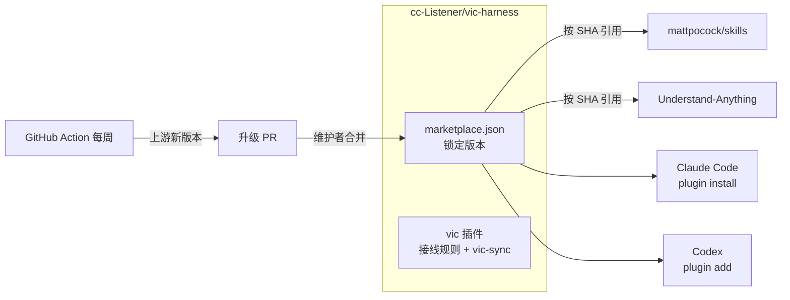

# vic-harness

[](https://github.com/cc-Listener/vic-harness/actions/workflows/check.yml)
[](https://github.com/cc-Listener/vic-harness/actions/workflows/upstream.yml)
[](LICENSE)

一个插件装好整套 AI 编程工作流：把 [mattpocock/skills](https://github.com/mattpocock/skills)（工作流）和 [Understand-Anything](https://github.com/Egonex-AI/Understand-Anything)（代码知识图谱）锁定版本、接在一起，并按周期自动升级。支持 **Claude Code** 和 **Codex**。

## 目录

- [为什么需要它](#为什么需要它)
- [特性](#特性)
- [工作原理](#工作原理)
- [前置要求](#前置要求)
- [快速开始](#快速开始)
- [安装](#安装)
- [使用](#使用)
- [升级与反思](#升级与反思)
- [常见问题](#常见问题)
- [项目结构](#项目结构)
- [开发](#开发)
- [贡献](#贡献)
- [致谢](#致谢)
- [许可证](#许可证)

## 为什么需要它

带团队或换新电脑时，原本要分别去两个 GitHub 仓库安装插件，各人装到的版本也不一样。两个插件彼此不知道对方存在：Matt 的工作流不会去查 UA 的代码图谱。

vic-harness 解决这三件事：

1. **一处安装**：一条命令装好两个上游加 vic 接线层，全团队用同一组锁定版本。
2. **理清关系**：写明 Matt 工作流的哪一步该调用 UA 的哪个能力。
3. **持续更新**：上游发布新版本时自动开 PR；合并后成员机器自动拉取。

它只做分发和接线，不复制、不重写上游的代码或 skill。

## 特性

| 组成 | 作用 |
|---|---|
| `mattpocock-skills` | 怎么做事：grilling → spec → tickets → implement/tdd → code-review → retro |
| `understand-anything` | 代码是什么：知识图谱、领域流程、diff 影响分析 |
| `vic:vic` | 接线规则：在实现、诊断、评审、规划前该查图谱的哪一部分 |
| `vic:vic-sync` | 升级与反思：升级上游、修复失效的接线、把 retro 结论落到规则或检查中 |

- 上游按 commit SHA 锁定，版本只写在 [`.claude-plugin/marketplace.json`](.claude-plugin/marketplace.json) 一处。
- 接线表里引用的每个上游 skill，都会在锁定版本上自动校验是否存在。
- Claude Code 与 Codex 都从同一个 marketplace 以插件形式安装；Claude Code 通过插件依赖一条命令装全。
- 零 npm 依赖，只需要 Node >= 18。

## 工作原理



会话开始时，agent 会收到一行指针，提示它先读 `vic:vic` 的接线规则：Claude Code 通过插件自带的 SessionStart hook 注入，Codex 通过 `~/.codex/AGENTS.md` 里一个带标记的段落。规则本身随插件更新，不复制到业务仓库。

## 前置要求

- Claude Code 或 Codex CLI（Codex 已在 0.166.0 上验证）
- Git
- Node.js >= 18（Codex 写入接线指针，以及开发时需要）

## 快速开始

Claude Code：

```bash
claude plugin marketplace add cc-Listener/vic-harness
```

```bash
claude plugin install vic@vic-harness
```

重启 Claude Code，然后在业务仓库里运行一次 `/mattpocock-skills:setup-matt-pocock-skills` 和 `/understand-anything:understand`。

## 安装

### Claude Code

```bash
claude plugin marketplace add cc-Listener/vic-harness
```

```bash
claude plugin install vic@vic-harness
```

这会一次装好 `vic`、`mattpocock-skills`、`understand-anything` 三个插件，重启后生效。

如果之前从别的来源装过 Matt 或 UA，例如官方目录的 `mattpocock-skills@claude-plugins-official`，先卸掉它，否则同一批 skill 会出现两份：

```bash
claude plugin uninstall mattpocock-skills@claude-plugins-official
```

**开启自动更新。** 第三方 marketplace 默认关闭自动更新。在 `~/.claude/settings.json` 里给 vic-harness 加上 `autoUpdate`：

```json
{
  "extraKnownMarketplaces": {
    "vic-harness": { "source": { "source": "github", "repo": "cc-Listener/vic-harness" }, "autoUpdate": true }
  }
}
```

这里的 `source` 必须和添加 marketplace 时的来源一致：`marketplace add cc-Listener/vic-harness` 对应 `github` 类型。不一致时 Claude Code 会忽略这个 marketplace，三个插件全部加载失败。

### Codex

Codex 也从同一个 marketplace 以插件形式安装。Codex 插件没有依赖机制，三个插件要分别添加：

```bash
codex plugin marketplace add cc-Listener/vic-harness
```

```bash
codex plugin add vic@vic-harness
```

```bash
codex plugin add mattpocock-skills@vic-harness
```

```bash
codex plugin add understand-anything@vic-harness
```

Codex 目前不加载插件自带的 hook，所以还需要在 `~/.codex/AGENTS.md` 里写一行指针，让 agent 知道先读接线规则。用安装脚本可以一次做完上面四步再加上这一步：

```bash
git clone https://github.com/cc-Listener/vic-harness.git
```

```bash
node vic-harness/scripts/vic.mjs codex-install
```

脚本还会清理旧版单独添加的 `mattpocock`、`understand-anything` marketplace，避免同一批 skill 出现两份。指针段带标记，标记外的内容不动。重复运行是安全的，加 `--dry-run` 只打印命令、不执行。

**升级：**

```bash
codex plugin marketplace upgrade vic-harness
```

## 使用

调用前缀：Claude Code 用 `/`，Codex 用 `$`。

1. **第一次接入业务仓库**：运行 `/mattpocock-skills:setup-matt-pocock-skills`（配置 issue tracker 和文档布局）和 `/understand-anything:understand`（生成代码图谱）。
2. **日常工作**：照常使用 Matt 的工作流。agent 会按接线表，在需要时查询图谱：

   | 场景 | Matt 侧 | UA 侧 |
   |---|---|---|
   | 讨论需求、术语 | `grill-with-docs` | `understand-domain` |
   | 写 spec、拆 ticket | `to-spec`、`to-tickets` | `understand-chat` |
   | 实现 ticket | `implement`、`tdd` | `understand-explain` |
   | 诊断 bug | `diagnosing-bugs` | `understand-chat`、`understand-explain` |
   | 评审与 PR | `code-review`、`pr` | `understand-diff` |
   | 新成员上手 | `ask-matt` | `understand-onboard` |

   完整规则见 [`plugins/vic/skills/vic/SKILL.md`](plugins/vic/skills/vic/SKILL.md)。
3. **不确定用哪个 skill**：运行 `/mattpocock-skills:ask-matt`。

## 升级与反思

- **自动**：[`.github/workflows/upstream.yml`](.github/workflows/upstream.yml) 每周一查询上游。只要上游发布了新版本（`plugin.json` 的 `version` 变化），就开一个 PR，附上版本变化和接线检查结果，由维护者审阅后合并。只有新 commit、没有新版本时不开 PR。
- **手动**：在本仓库运行 `/vic:vic-sync`。它会升级上游、修复失效的接线，并把本周期的 retro 结论分类落地：改接线表、加检查、整理给上游的 issue 草稿，或者归为个人偏好。

合并后，Claude Code 在开启自动更新时会自动拉取新版本；Codex 运行 `codex plugin marketplace upgrade vic-harness`。

## 常见问题

**`vic` 显示 `failed to load: Dependency ... is not installed`**

先单独安装缺的依赖，再重启：

```bash
claude plugin install understand-anything@vic-harness
```

**克隆时报 `Connection closed by ... port 22`**

所在网络封了 SSH 的 22 端口。上游条目已经改用 HTTPS 克隆，不受影响。如果你自己推送这个仓库时遇到同样的问题，在 `~/.ssh/config` 里把 `github.com` 指到 `ssh.github.com` 的 443 端口。

**同一个 skill 出现两份**

同一个上游插件从两个来源装了两次，例如官方目录一份、vic-harness 一份。卸掉非 vic-harness 的那一份。

**开启自动更新后，三个插件都加载失败**

`extraKnownMarketplaces` 里 vic-harness 的 `source` 和添加时的来源不一致，见 [安装](#claude-code)。

## 项目结构

```
.claude-plugin/marketplace.json   唯一的版本来源：vic 与两个上游的锁定版本
plugins/vic/                      vic 插件
  skills/vic/SKILL.md             接线规则
  skills/vic-sync/SKILL.md        升级与反思流程
  hooks/                          Claude Code 的 SessionStart 指针
scripts/vic.mjs                   check / codex-install / upstream
tests/                            单元测试
.github/workflows/                check（每次推送）与 upstream（每周）
docs/adr/                         设计决策
GLOSSARY.md                       术语
```

## 开发

```bash
node --test
```

```bash
node scripts/vic.mjs check
```

- `check`：校验 marketplace，并在锁定版本上校验接线引用（会克隆上游）；加 `--offline` 只做结构校验。
- `upstream`：查询上游最新版本，不写文件；加 `--write` 写回锁定版本。

修改 `plugins/vic/` 下的内容后，要把 [`plugins/vic/.claude-plugin/plugin.json`](plugins/vic/.claude-plugin/plugin.json) 的 `version` 加一，否则成员机器不会更新。设计决策见 [docs/adr/](docs/adr/)，术语见 [GLOSSARY.md](GLOSSARY.md)，agent 指南见 [AGENTS.md](AGENTS.md)。

## 贡献

欢迎提 issue 和 PR。修改接线规则时，请说明它解决了哪一次真实使用中遇到的问题；没有真实信号支撑的"可能更好"不会合并。提交前确保 `node --test` 和 `node scripts/vic.mjs check` 都通过。

属于上游 skill 本身的问题，请直接反馈给 [mattpocock/skills](https://github.com/mattpocock/skills) 或 [Understand-Anything](https://github.com/Egonex-AI/Understand-Anything)。

## 致谢

- [mattpocock/skills](https://github.com/mattpocock/skills)：Matt Pocock 的工程 skill 集（MIT）
- [Understand-Anything](https://github.com/Egonex-AI/Understand-Anything)：Egonex 的代码知识图谱插件（MIT）

## 许可证

[MIT](LICENSE)
